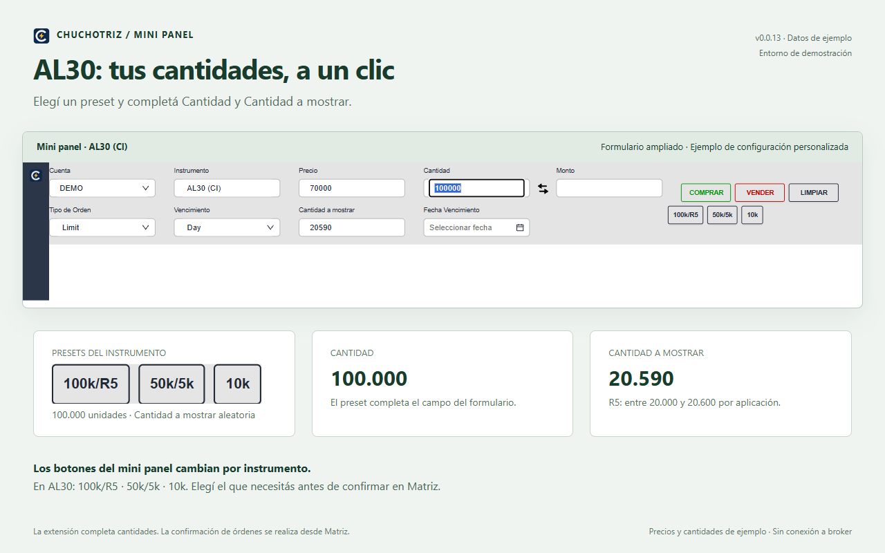
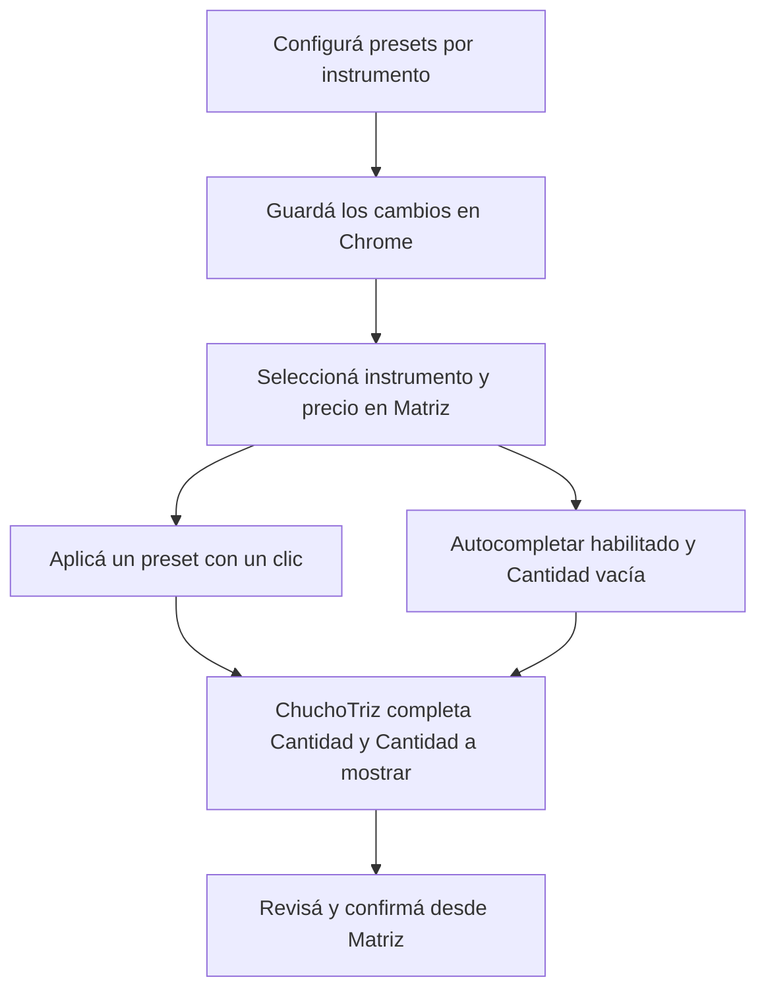
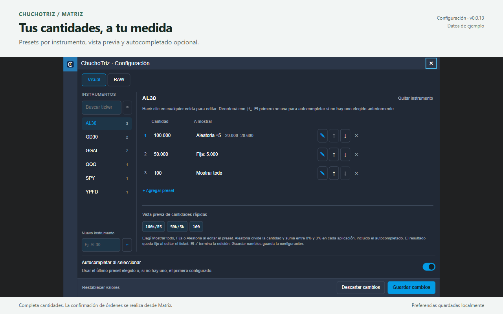
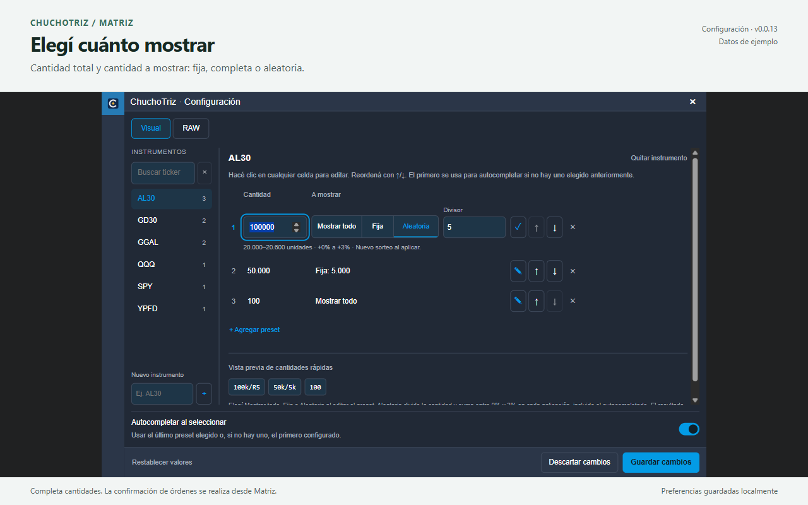
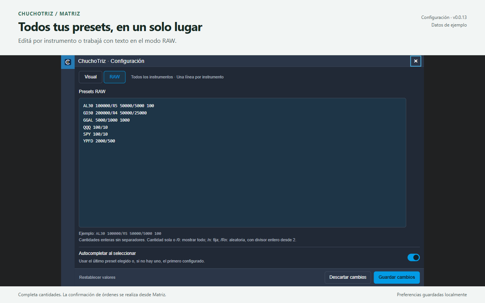

<p align="center">
  
</p>

# ChuchoTriz

**Tus cantidades por instrumento, a un clic en Matriz.**

Extensión de Chrome que agrega botones de cantidades rápidas al Mini Order Form
de Matriz. Configurá tus presets, elegí cuánto mostrar y reutilizalos al cambiar
de instrumento.

**ChuchoTriz completa cantidades. La revisión y confirmación de órdenes se
realizan desde Matriz.**

[Instalar](#instalar) · [Cómo se usa](#cómo-se-usa) ·
[Configurar presets](#configurar-presets) · [Desarrollo](#desarrollo-y-verificación) ·
[Privacidad](PRIVACY.md)



*Capturas de la versión 0.0.13 en un entorno de demostración, con datos
simulados y sin conexión a un broker. La apariencia de Matriz puede variar.*

## Qué podés hacer

| Función | Para qué sirve |
| --- | --- |
| **Presets por instrumento** | Tener cantidades distintas para cada ticker y aplicarlas con un clic. |
| **Cantidad a mostrar** | Mostrar todo, fijar una cantidad visible o usar una regla aleatoria como `R5`. |
| **Autocompletar opcional** | Reutilizar el último preset elegido o el primero configurado cuando Cantidad está vacía. |
| **Editor visual** | Buscar, agregar y quitar instrumentos; editar y reordenar presets con vista previa de los botones. |
| **Modo RAW** | Editar todos los instrumentos como texto, con una línea por ticker. |
| **Preferencias locales** | Guardar la configuración en el perfil de Chrome y actualizarla entre vistas. |

Compatible con `https://*.xoms.com.ar/*` y `https://remarkets.matriz.com.ar/*`.

## Instalar

### Desde un ZIP de GitHub

1. Descargá el ZIP de una [release](https://github.com/ChuchoCoder/ChuchoTriz/releases)
   y descomprimilo en una carpeta permanente.
2. Abrí `chrome://extensions` y habilitá **Modo de desarrollador**.
3. Elegí **Cargar extensión sin empaquetar** y seleccioná la carpeta que contiene
   `manifest.json`.
4. Abrí o recargá Matriz. Pulsá el icono de ChuchoTriz en su barra izquierda para
   abrir **Configuración**.

Las releases anteriores pueden contener una versión anterior de la interfaz.
También podés [compilar esta rama](#desarrollo-y-verificación) y cargar la carpeta
`dist`.

Para actualizar una instalación de desarrollo, reemplazá el contenido de su
carpeta, pulsá **Recargar** en Chrome y recargá Matriz. Conservar la misma carpeta
mantiene su identidad y configuración de desarrollo.

## Cómo se usa

1. **Configurá** uno o más presets para tus instrumentos y pulsá **Guardar cambios**.
2. **Seleccioná un instrumento y un precio** en el Mini Order Form de Matriz.
3. **Aplicá un preset** con sus botones, o usá Autocompletar si está habilitado y
   el campo Cantidad está vacío.
4. **Revisá el formulario** y confirmá la operación desde Matriz cuando corresponda.



**Autocompletar** viene activado en una instalación nueva y puede desactivarse
desde Configuración. Usa el último preset elegido para ese instrumento durante
la sesión o, si todavía no elegiste uno, el primero de la lista.
**Limpiar** olvida esa última elección para el instrumento durante la sesión.

El formulario se conserva contraído al iniciar. Sólo se expande al aplicar un
preset con Cantidad a mostrar mayor que cero, también mediante Autocompletar.
Si ya está expandido, un preset sin cantidad parcial limpia Cantidad a mostrar
y conserva el formulario abierto.

## Configurar presets

Abrí **Configuración** desde el icono de ChuchoTriz en la barra izquierda de
Matriz. La extensión no agrega un popup de configuración a la barra superior
de Chrome.

### Editor visual

Buscá o agregá un instrumento en la lista alfabética de la izquierda. Cada fila
de la derecha representa un preset; la vista previa muestra cómo quedarán sus
botones en Matriz.



- Hacé clic en una celda o en el lápiz para editar **Cantidad** y **A mostrar**.
- Usá las flechas de reordenamiento para cambiar la prioridad de los presets:
  el primero se usa para autocompletar cuando no hay una elección anterior.
  El reordenamiento también puede hacerse con teclado.
- Terminá la edición de una fila con **✓** o con **Enter** en un campo.
- Pulsá **Guardar cambios** para guardar todos los presets. **Descartar cambios**
  permite volver a la configuración guardada.

La extensión valida las cantidades y permite recuperar el borrador ante errores
al guardar. Si otra vista actualiza las preferencias mientras editás, avisa del
conflicto con los cambios pendientes.

### Cantidad a mostrar: completa, fija o aleatoria

| Modo | Ejemplo en RAW | Resultado |
| --- | --- | --- |
| **Mostrar todo** | `100` o `100/0` | Cantidad total de 100, sin cantidad parcial. |
| **Fija** | `100/20` | Cantidad total de 100 y cantidad a mostrar de 20. |
| **Aleatoria** | `100000/R5` | Cantidad total de 100.000 y cantidad a mostrar entre 20.000 y 20.600. |

En **A mostrar** podés ingresar un número fijo, `0` para mostrar todo o `Rn`,
donde `n` es un divisor entero desde 2, como `R2`, `R3` o `R5`.

<details>
<summary>Ver la edición de una cantidad aleatoria</summary>



Cantidad, modo y valor o divisor comparten la misma línea en pantallas amplias.
En Aleatoria también se muestra el rango posible.

</details>

Con Cantidad `100000` y A mostrar `R5`, el botón es `100k/R5`. Cada aplicación
sortea un entero entre `20000` y `20600`, ambos incluidos: cantidad dividida por
5, más hasta un 3%. Los límites se redondean hacia abajo, con un mínimo de una
unidad y sin superar la cantidad total.

El autocompletado también realiza un nuevo sorteo, incluso al reutilizar el
último preset elegido. Cambiar manualmente Cantidad conserva el valor sorteado
hasta volver a aplicar el preset; Matriz valida la relación entre ambas
cantidades. La configuración guarda la regla, no el resultado.

### Modo RAW

El selector **Visual / RAW** permite cambiar de editor conservando el borrador.
RAW usa una línea por instrumento y cantidades enteras sin separadores:

```text
AL30 100000/R5 50000/5000 100
GD30 200000/R4 50000/25000
```

Por ejemplo, la primera línea configura tres botones para AL30: `100k/R5`,
`50k/5k` y `100`.

<details>
<summary>Ver el editor RAW</summary>



</details>

El orden de los presets y de las líneas se conserva al guardar. Los errores
indican su número de línea y deben corregirse antes de guardar o volver al
modo visual. **Guardar cambios**, **Restablecer valores** y **Descartar cambios**
funcionan también en RAW.

## Desarrollo y verificación

Usá Node.js 24 LTS y npm, como en CI.

```sh
npm ci --ignore-scripts --no-audit
npm run security:check
npm test
npm run package:free
```

Esta rama genera la versión **0.0.13** y el paquete
`releases/chuchotriz-free-0.0.13.zip`. Podés cargar `dist` directamente desde
Chrome para probar la extensión.

| Comando | Qué hace |
| --- | --- |
| `npm test` | Ejecuta las pruebas de la extensión y de las guardas de distribución. |
| `npm run security:check` | Ejecuta los controles de política y lint de seguridad y sus pruebas. |
| `npm run check:free` | Comprueba la lista de archivos permitidos y el alcance de la extensión. |
| `npm run build` | Ejecuta TypeScript, compila y valida los archivos fuente y el contenido de `dist`. |
| `npm run watch` | Recompila durante el desarrollo; validá con `package:free` antes de distribuir. |
| `npm run package:free` | Compila, valida y genera el ZIP de distribución. |

CI ejecuta las pruebas, valida la extensión, genera el ZIP y comprueba las
dependencias. Los nuevos archivos requieren una revisión explícita y su
incorporación en `free-files.json`.

## Datos y distribución

Las preferencias se almacenan localmente en `chrome.storage.local`, dentro del
perfil de Chrome. Se conservan las claves `InstrumentPresets` y `Autocomplete`
de versiones anteriores; el último preset elegido se mantiene en memoria
durante la sesión.

La extensión usa Manifest V3, pide solamente el permiso `storage` y no incorpora
servidores propios, analítica ni pagos. No bloquea las solicitudes de telemetría
de Matriz.

- [Privacidad](PRIVACY.md).
- [Mantenimiento y distribución](docs/distribution.md).
- [Reportar problemas o proponer mejoras](https://github.com/ChuchoCoder/ChuchoTriz/issues).
